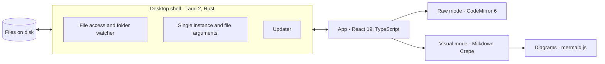

<div align="center">


# MDE

**A markdown editor for the files your AI agents read and write.**

Edit raw markdown or a WYSIWYG view of the same file.<br>
When an agent changes an open file, MDE reloads it, or shows you the diff first.

[](https://github.com/sevenevesai/MDE/releases/latest)
[](https://github.com/sevenevesai/MDE/actions/workflows/ci.yml)

[](LICENSE)

[**Download**](https://github.com/sevenevesai/MDE/releases/latest) ·
[Open in browser](https://seveneves.ai/mde/app/) ·
[Website](https://seveneves.ai/mde/) ·
[For AI agents](#for-ai-agents) ·
[Report a bug](https://github.com/sevenevesai/MDE/issues/new)

</div>

---

## Why MDE

Plans, specs, notes and agent instructions live in markdown files that coding agents rewrite
while you have them open, and that you paste into chats. You want to read them rendered, fix them
as raw text, and never save a stale copy over an agent's latest version.

MDE gives you both views of one file, watches every open file for outside changes, and copies a
document with its path in a form you can paste straight into a chat. It calls no AI service
itself: it is the surface agents write to, not another chat client. The desktop app is built on
Tauri, and the same editor runs in a browser.

## Features

### Write and edit

- **Two views of one file.** Raw mode is CodeMirror 6 with markdown highlighting, line numbers,
  folding, find and replace, and a minimap. Visual mode is a WYSIWYG editor (Milkdown Crepe) with
  tables, task lists, images, highlighted code blocks and a `/` block menu. **Ctrl+E** switches.
- **Formatting toolbar and shortcuts** in raw mode for headings, bold, italic, strikethrough,
  code, links, images, lists, quotes, code blocks and rules.
- **Tables and task lists.** **Format Table** pads and aligns the pipe table at the cursor.
  **Ctrl+Shift+9** toggles a task checkbox, and checkboxes are clickable in visual mode.
- **Outline sidebar** (**Ctrl+Shift+O**, raw mode): the document's headings; click one to jump
  there. Heading sections fold.
- **YAML frontmatter** is highlighted and folds as one block in raw mode.
- **Mermaid diagrams.** ` ```mermaid ` fences render as diagrams in visual mode. The diagram
  library loads only when a document contains one.

### Work alongside AI agents

- **Live reload** (desktop). MDE watches every open file. When an agent or another editor changes
  one, a tab with no unsaved edits reloads and says so in a notice. A tab with unsaved edits gets
  a conflict bar: **Reload from disk**, **Keep my version** or **View diff**.
- **Diff view** (**Ctrl+Shift+D**): your buffer side by side with the last saved version, or,
  from the conflict bar, with the new version on disk.
- **Copy for AI** (**Ctrl+Shift+A**) copies the file path, then the document in one fenced block.
  The fence is longer than any backtick run in the document, so code blocks inside it can't end
  it early:

  ````text
  C:\projects\app\PLAN.md
  ```markdown
  # Plan
  …
  ```
  ````

- **Clean AI Paste** fixes text pasted from chat tools and word processors, in the selection or
  the whole document. It removes zero-width characters and byte-order marks, turns non-breaking
  spaces into spaces, and straightens curly quotes.
- **Token estimate** in the status bar, next to the word count: characters ÷ 4, marked as
  approximate.

### Files, tabs and sessions

- **Tabs.** Each tab keeps its own undo history and scroll position. Drag tabs to reorder them,
  right-click one for **Close Others** and **Copy Path**, and double-click the empty strip for a
  new tab.
- **Hot exit** (desktop). Closing the window never asks to save. Open tabs, unsaved edits
  included, come back on the next launch, and the session is also saved every 10 seconds. Files
  that changed on disk while MDE was closed are checked on restore like a live change.
- **Auto-Save** (desktop, off by default, in the Edit menu) saves edited files about 1.5 seconds
  after the last change. It skips tabs in conflict with the file on disk.
- **One window.** Files opened from Explorer, a file manager or the command line arrive as tabs
  in the running window. MDE registers for `.md`, `.markdown`, `.mdx` and `.txt`, and accepts
  dropped files of those types.
- **Command palette** (**Ctrl+K**): every command, plus the 10 most recent files on desktop,
  fuzzy-matched.
- **Export.** **File → Export HTML…** writes a standalone HTML page; **Edit → Copy as HTML**
  puts the rendered HTML on the clipboard.

## Install

Download from [the latest release](https://github.com/sevenevesai/MDE/releases/latest), or
[use it in the browser](https://seveneves.ai/mde/app/) with nothing to install.

| Platform | File | First launch |
|---|---|---|
| Windows x64 | `MDE_<version>_x64-setup.exe` (per-user) or `MDE_<version>_x64_en-US.msi` | The installers are not code-signed. In SmartScreen, choose **More info → Run anyway**. |
| macOS, Apple Silicon | `MDE_<version>_aarch64.dmg` | The app is not signed or notarized. Open it once, then choose **Open Anyway** in System Settings → Privacy & Security. If macOS says the app is damaged, run `xattr -cr /Applications/MDE.app` and open it again. |
| macOS, Intel | `MDE_<version>_x64.dmg` | As for Apple Silicon. |
| Linux x64 | `MDE_<version>_amd64.deb`, `MDE-<version>-1.x86_64.rpm` or `MDE_<version>_amd64.AppImage` | Make the AppImage executable with `chmod +x`. It needs FUSE 2. |

MDE runs in the system webview: WebView2 on Windows, WebKit on macOS, WebKitGTK on Linux.

**Updates.** Every installer above updates in-app. MDE checks GitHub Releases a few seconds after
launch and, when a new version is out, offers **Restart to update**. **Help → Check for
Updates…** checks on demand.

## Quick start

1. Open a markdown file with **File → Open…** (**Ctrl+O**), by dropping it on the window, or with
   **Open with → MDE** in Explorer or your file manager (Windows and Linux).
2. Press **Ctrl+E** to switch between raw and visual mode.
3. Leave the file open while an agent edits it. A clean tab reloads; a tab with unsaved edits
   shows the conflict bar, where **View diff** shows both versions.
4. Press **Ctrl+Shift+A** to copy the document for a chat.

> [!IMPORTANT]
> Closing the window keeps unsaved edits for the next launch, but does not write them to the
> file. Save with **Ctrl+S**, or turn on **Auto-Save**, before another program reads the file.

## Keyboard shortcuts

On macOS, app shortcuts accept Cmd or Control, and editing shortcuts use Cmd.

| App | Action |
|---|---|
| `Ctrl+N` / `Ctrl+O` | New tab / open file |
| `Ctrl+S` / `Ctrl+Shift+S` | Save / save as |
| `Ctrl+W` | Close tab |
| `Ctrl+Tab` / `Ctrl+Shift+Tab` | Next / previous tab (also `Ctrl+PageDown` / `Ctrl+PageUp`) |
| `Ctrl+K` | Command palette |
| `Ctrl+E` | Switch raw / visual mode |
| `Ctrl+Shift+O` | Outline sidebar |
| `Ctrl+Shift+D` | Diff unsaved changes |
| `Ctrl+Shift+A` | Copy for AI |
| `Ctrl+Alt+W` | Word wrap (also **Edit → Toggle Word Wrap**) |
| `Ctrl+=` / `Ctrl+-` / `Ctrl+0` | Font size up / down / reset (10–24 px) |

| Editing, raw mode | Action |
|---|---|
| `Ctrl+B` / `Ctrl+I` | Bold / italic |
| `Ctrl+Shift+X` | Strikethrough |
| ``Ctrl+` `` | Inline code |
| `Ctrl+1` … `Ctrl+4` | Heading 1–4 |
| `Ctrl+Shift+L` / `Ctrl+Shift+K` | Link / image |
| `Ctrl+Shift+8` / `Ctrl+Shift+7` | Bulleted / numbered list |
| `Ctrl+Shift+9` | Toggle task checkbox |
| `Ctrl+Shift+.` | Blockquote |
| ``Ctrl+Shift+` `` | Code block |
| `Ctrl+F` | Find and replace |

## For AI agents

MDE is the editor a person keeps open while an agent works on their files. It has no API; an
agent works with it through files and the command line.

**Open files in the person's MDE window.** Pass absolute paths to the installed binary. If MDE is
running, the files open as tabs in that window and the new process exits; a file that is already
open becomes the active tab. If MDE is not running, it starts with those files. Only `.md`,
`.markdown`, `.mdx` and `.txt` paths are used, and arguments that start with `-` are ignored. The
command prints nothing.

```powershell
# Windows (per-user install)
& "$env:LOCALAPPDATA\MDE\mde.exe" "C:\projects\app\PLAN.md"
```

```bash
# Linux (.deb or .rpm put mde on PATH)
mde /home/me/projects/app/PLAN.md
```

**Write files the person has open.** Write in place or replace the file by renaming a temp file
over it; MDE watches the folder, so it sees both. A clean tab reloads. A tab with unsaved edits
shows a conflict, and the person chooses which version to keep.

**Boundaries.** MDE writes to a document only on **Save**, **Save As** or **Auto-Save**, and
Auto-Save is off by default and skips tabs in conflict. It has no permission to delete or rename
files.

**Read what the person pastes.** Copy for AI produces the file path on the first line, then the
document inside a fenced `markdown` block, as shown under [Features](#work-alongside-ai-agents).

## How it works



- **App** [React 19, TypeScript, Tailwind CSS 4]: tabs, menus, command palette and session
  state, in `src/`. The browser build is the same app without the desktop shell.
- **Raw mode** [CodeMirror 6]: one editor per tab, so undo history and scroll position survive
  tab switches. Word, character and token counts update after a 250 ms pause in typing.
- **Visual mode** [Milkdown Crepe]: loads the first time you switch to it, so it adds nothing to
  startup. mermaid.js loads only when a diagram appears.
- **Desktop shell** [Tauri 2, Rust]: file access, the folder watcher, single-instance forwarding,
  window size and position, and the updater, in `src-tauri/`. It watches each open file's folder
  rather than the file, because editors and agents often save by renaming a temp file over it.

## Privacy

- The desktop app's network requests are the update check to GitHub Releases and any remote
  images a document embeds, which visual mode loads.
- Documents, the hot-exit session and settings stay on your machine, in the app's local storage
  and your files.
- In the browser, your documents never leave the browser. The hosted copy at seveneves.ai logs a
  page view (path, referrer, screen size and language) to that site.

## Known limitations

- **macOS:** MDE does not yet handle Finder's open-file events, so opening a file from Finder
  starts MDE without the file. Use **File → Open…** or drop the file on the window.
- The outline sidebar and formatting toolbar are raw mode only; Mermaid diagrams render in
  visual mode only.
- The minimap turns off for documents over 10,000 lines.
- There is one theme, dark.
- Hot exit keeps unsaved edits in the app's local storage, which has a size limit; save very
  large documents rather than relying on it.
- **In the browser:** there is no live reload, Auto-Save, recent files or updating. Chrome and
  Edge save back to the opened file; other browsers download a copy, as does Save on a tab
  restored after a page reload. The browser keeps some shortcuts for itself, such as `Ctrl+N`,
  `Ctrl+W` and `Ctrl+Tab`.

## Build from source

Prerequisites: [Node.js](https://nodejs.org) 20 or later, [Rust](https://rustup.rs) stable, and
the [Tauri 2 system prerequisites](https://v2.tauri.app/start/prerequisites/) for your platform.

```bash
npm install
npm run tauri dev        # desktop app with hot reload
npm run tauri build      # desktop installers → src-tauri/target/release/bundle/
npm run dev              # browser version on http://localhost:1420
npm run build:web        # static browser build → dist-web/
```

`npm run tauri build` signs update artifacts with the project's private key. Without
`TAURI_SIGNING_PRIVATE_KEY` set, it builds the installers, then exits 1 with "A public key has
been found, but no private key". To build without update artifacts:

```bash
npm run tauri build -- --config '{"bundle":{"createUpdaterArtifacts":false}}'
```

In PowerShell, save that JSON to a file and pass the file's path to `--config` instead.

CI runs these on every push and pull request to `main`:

```bash
npm run typecheck        # tsc --noEmit
npm test                 # vitest
npm run build            # tsc + vite build
```

## Project structure

```text
src/                 React app: App.tsx, platform detection, AI tools, session and settings
  components/        tab bar, menus, toolbar, command palette, outline, diff overlay
  editor/            CodeMirror and Milkdown setup, editing commands, diff view, Mermaid
  store/             tab and document state
src-tauri/           Tauri shell: Rust entry point, config, capabilities, icons
scripts/             web deploy script
.github/workflows/   CI, and the release build for all platforms
```

Tests sit next to the code they cover, in `__tests__/` folders.

## Contributing

Report bugs and request features in [Issues](https://github.com/sevenevesai/MDE/issues). Pull
requests to `main` run the CI checks above.

## License

[MIT](LICENSE).
